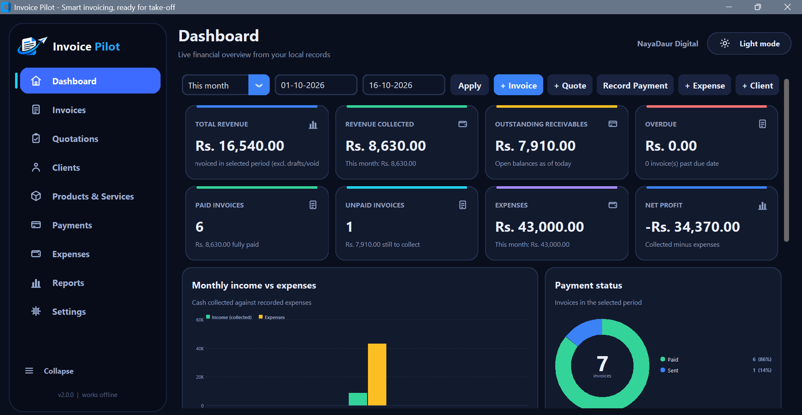
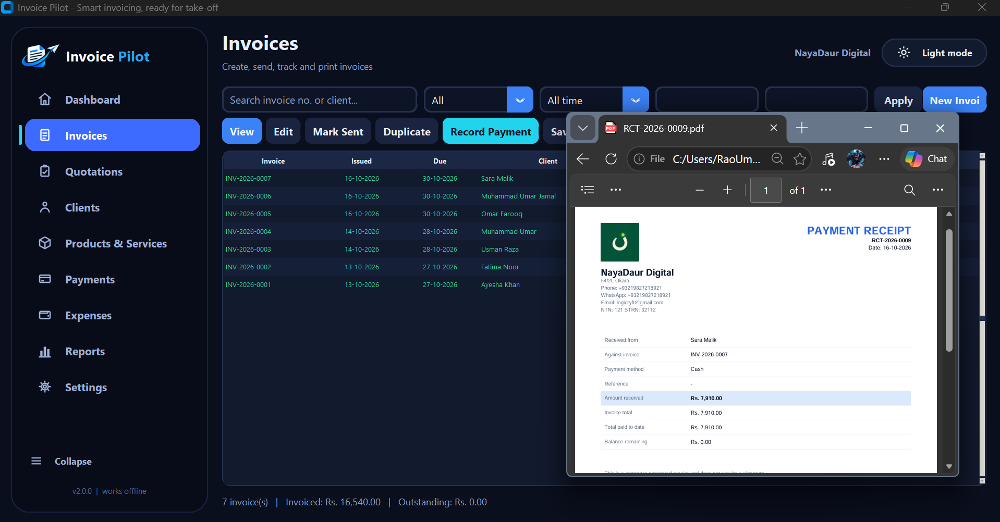
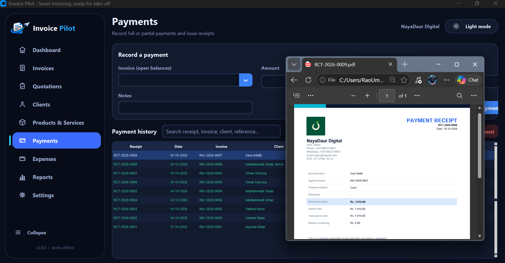
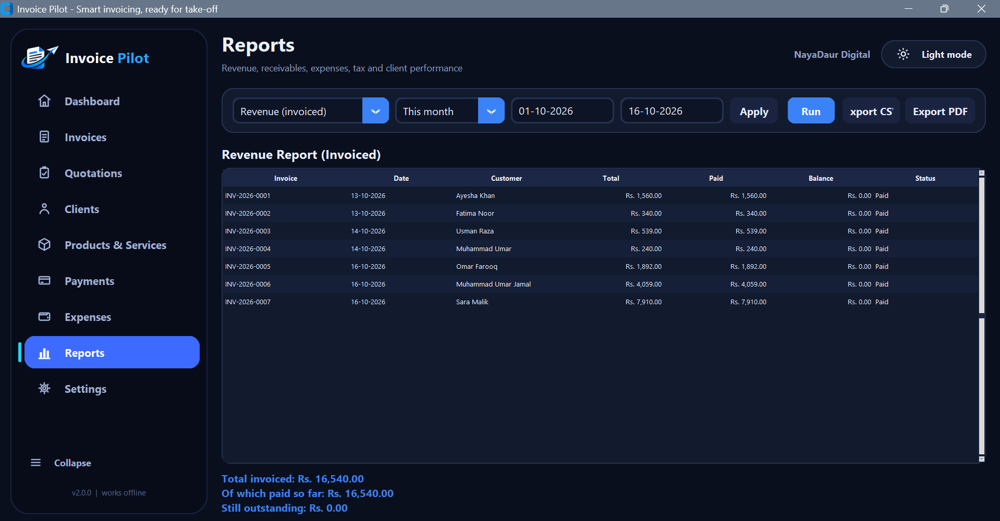
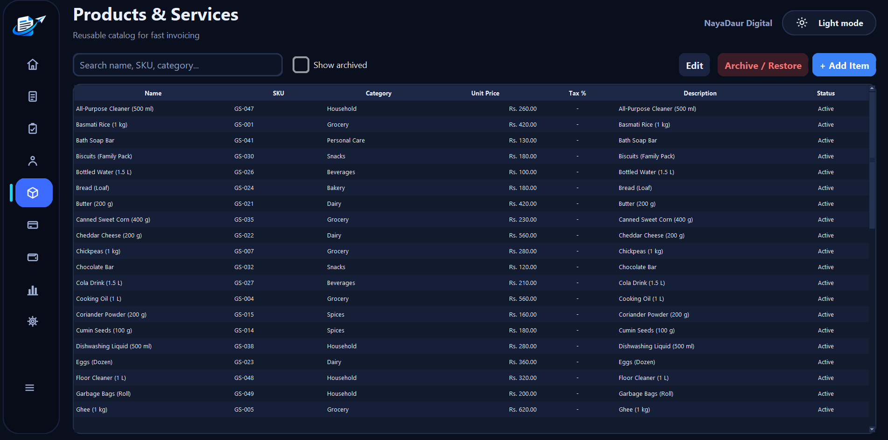
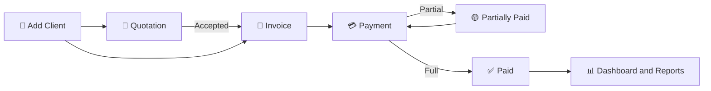

<!-- ========================= HEADER ========================= -->
<p align="center">
  
</p>

<p align="center">
  <a href="https://github.com/MUdevelops/InvoicePilot">
    
  </a>
</p>

<p align="center">
  
  
  
  
  
  
</p>

<p align="center">
  <a href="https://youtu.be/LQNCx1324is"><b>▶ Watch the Demo</b></a> &nbsp;•&nbsp;
  <a href="#-quick-start"><b>🚀 Quick Start</b></a> &nbsp;•&nbsp;
  <a href="#-features"><b>✨ Features</b></a> &nbsp;•&nbsp;
  <a href="#-testing"><b>🧪 Tests</b></a>
</p>

---

<!-- ========================= VIDEO ========================= -->
<p align="center">
  
</p>

<p align="center">
  <a href="https://youtu.be/LQNCx1324is">
    
  </a>
</p>

<p align="center"><i>Click the image to watch the full walkthrough of the interface on YouTube.</i></p>

---

<!-- ========================= OVERVIEW ========================= -->
<p align="center">
  
</p>

**Invoice Pilot** is an offline invoicing and financial-dashboard application for Windows. It replaces paper registers and scattered spreadsheets with one clean screen where you can create invoices, record payments, issue quotations, track expenses, and see your profit.

Everything is stored locally in a SQLite database on your own computer. Nothing is emailed, uploaded or sent to any server.

> **Who is it for?** Shopkeepers, mall and market owners, freelancers and small businesses that want professional invoices, receipts and reports without a monthly subscription.

---

<!-- ========================= FEATURES ========================= -->
<p align="center">
  
</p>

| | Area | What you get |
|---|---|---|
| 📊 | **Dashboard** | KPI cards (revenue, collected, expenses, outstanding, overdue, net profit) and interactive charts. Date presets: *This month, Last 30 days, This quarter, This year, All time, Custom*. |
| 🧾 | **Invoices** | Line items, discount (percent or fixed), per-line tax, automatic numbering, draft / sent / partially paid / paid / overdue / void statuses, duplicate, edit, void, print and PDF. |
| 💳 | **Payments** | Partial and full payments (Cash, Bank Transfer, Easypaisa, JazzCash, Card, Cheque, Other), numbered receipts, payment reversal, overpayment and duplicate-payment protection. |
| 📝 | **Quotations** | Draft, sent, accepted, declined and expired states. Accepted quotations convert into invoices exactly once. |
| 👥 | **Clients** | Client profiles, invoice history, archive and restore, printable statements. |
| 📦 | **Products** | Reusable items with SKU, category, unit price and default tax rate. |
| 💸 | **Expenses** | Categorized expenses that feed the dashboard and net profit instantly. |
| 📑 | **Reports** | 10 reports with PDF and CSV export (see below). |
| ⚙️ | **Settings** | Business profile (name, address, phone, WhatsApp, email, NTN, STRN), numbering, currency symbol, tax label and rate, payment terms, document footer. |
| 💾 | **Backup / Restore** | One-click database backup and validated restore with an automatic safety copy. |
| 🌗 | **Dark / Light theme** | Switch with one click. Your choice is remembered. |
| 🚀 | **Animated splash** | A branded 5-second splash screen that fades into the dashboard. |

<details>
<summary><b>📑 The 10 built-in reports</b></summary>

1. Revenue (invoiced)
2. Payments received
3. Outstanding payments
4. Overdue invoices
5. Receivables aging
6. Expenses
7. Tax summary
8. Client performance
9. Client statement
10. Monthly summary

</details>

---

<!-- ========================= SCREENSHOTS ========================= -->
<p align="center">
  
</p>

<p align="center">
  
  
  
  
  
  
</p>

---

<!-- ========================= QUICK START ========================= -->
<p align="center">
  
</p>

### Requirements

- Windows
- **Python 3.11.9** (3.11.x)
- Packages in `requirements.txt`: `customtkinter`, `reportlab`, `Pillow`

### Install and run

```bash
git clone https://github.com/MUdevelops/InvoicePilot.git
cd InvoicePilot

py -3.11 -m venv .venv
.\.venv\Scripts\activate
pip install -r requirements.txt

python main.py
```

**Even easier:** double-click **`run.bat`**. It finds Python 3.11, installs the packages on first run, and starts the app.

---

<!-- ========================= WORKFLOW ========================= -->
<p align="center">
  
</p>



1. **Add a client** (and optionally your products).
2. **Create a quotation** or go straight to an **invoice**.
3. **Record payments** as money arrives. Status and balance update automatically.
4. **Add expenses** so the dashboard shows your true net profit.
5. **Export reports** to PDF or CSV and **back up** your data.

---

<!-- ========================= RULES ========================= -->
<p align="center">
  
</p>

Invoice Pilot enforces its accounting rules in the data layer, so they apply on every screen.

| Rule | Behavior |
|---|---|
| **Money precision** | Amounts are stored as whole minor units (paisa) and rounded half-up, so there are no floating-point errors. |
| **Invoice status** | `Paid` when the balance is zero, `Overdue` when the due date has passed with a balance, `Partially Paid` after a part payment, otherwise `Sent`. Drafts and void invoices keep their own status. |
| **Overpayment** | A payment larger than the outstanding balance is rejected. |
| **Duplicate payment** | An identical payment recorded within seconds is blocked. |
| **Future-dated payment** | Not allowed. |
| **Payment reversal** | Reversing a payment recalculates the invoice balance and status. A payment can only be reversed once. |
| **Draft / void** | Payments cannot be recorded against draft or void invoices. |
| **Editing** | An invoice total cannot be lowered below what has already been paid. |
| **Quotation conversion** | Only *Accepted* quotations convert, and only once. A converted quotation is locked and kept as a record. |
| **Dashboard figures** | Calculated only from stored records. Void invoices and reversed payments are excluded. |
| **Time zone** | "Today" is calculated in Asia/Karachi time. |

---

<!-- ========================= STRUCTURE ========================= -->
<p align="center">
  
</p>

```text
InvoicePilot/
├── main.py            # UI: splash, sidebar, dark/light theme, dashboard charts, all screens
├── database.py        # SQLite schema, business rules, analytics, reports, backup/restore, PDF generation
├── tests.py           # pytest suite for the money, status, payment and conversion rules
├── requirements.txt   # Python dependencies
├── run.bat            # One-click launcher for Windows
└── README.md
```

### Where your data lives

| Item | Location |
|---|---|
| Database | `%APPDATA%\InvoicePilot\invoicepilot.db` |
| Exported PDFs | `%APPDATA%\InvoicePilot\exports\` |
| Safety copies made before a restore | `%APPDATA%\InvoicePilot\backups\` |

Set the `INVOICEPILOT_DATA_DIR` environment variable to use a different folder (this is also how the tests avoid touching your real data).

---

<!-- ========================= TESTING ========================= -->
<p align="center">
  
</p>

```bash
pip install pytest
python -m pytest tests.py -q
```

The suite uses a temporary database for every test and covers:

- money rounding, discounts and tax
- invoice status rules, overdue detection and recovery
- partial and full payments, reversals, overpayment and duplicate protection
- quotation, accepted and convert-once behavior
- expenses, dashboard figures, date ranges and aging buckets
- CSV export, PDF generation (invoice, quotation, receipt, report)
- backup, restore and rejection of invalid backup files

> The tests cover the data layer. The graphical interface is checked by running the app.

---

<!-- ========================= TECH ========================= -->
<p align="center">
  
</p>

| Layer | Technology |
|---|---|
| Language | Python 3.11.9 |
| Interface | CustomTkinter (with Tk Canvas charts) |
| Database | SQLite |
| PDF output | ReportLab |
| Images / logo | Pillow |

---

<!-- ========================= TROUBLESHOOTING ========================= -->
<p align="center">
  
</p>

<details>
<summary><b>"Python 3.11 not found" when using run.bat</b></summary>

Install Python 3.11.9 from the official Python downloads page and tick **Add Python to PATH**, then run `run.bat` again.

</details>

<details>
<summary><b>Packages fail to install</b></summary>

Make sure you have an internet connection for the first install, then run `pip install -r requirements.txt` inside the activated virtual environment.

</details>

<details>
<summary><b>Where is my data?</b></summary>

See the *Where your data lives* table above. Use **Backup** inside the app regularly and keep a copy on another drive.

</details>

---

<!-- ========================= AUTHOR ========================= -->
<p align="center">
  
</p>

<p align="center">
  <b>Muhammad Umar Jamal</b><br/>
  <i>Build AI. Engineer Systems. Ship Applications.</i><br/><br/>
  <a href="https://github.com/MUdevelops"></a>
  <a href="https://youtu.be/LQNCx1324is"></a>
</p>

<p align="center">⭐ If Invoice Pilot helps you, please give the repository a star!</p>

<p align="center">
  
</p>
